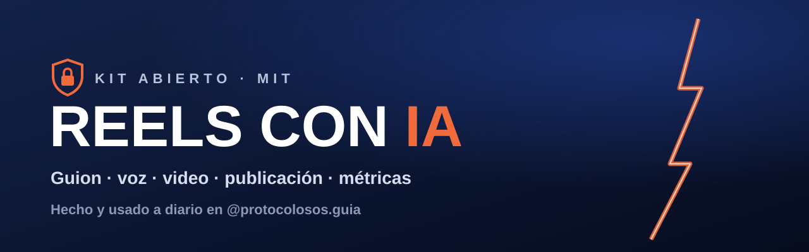
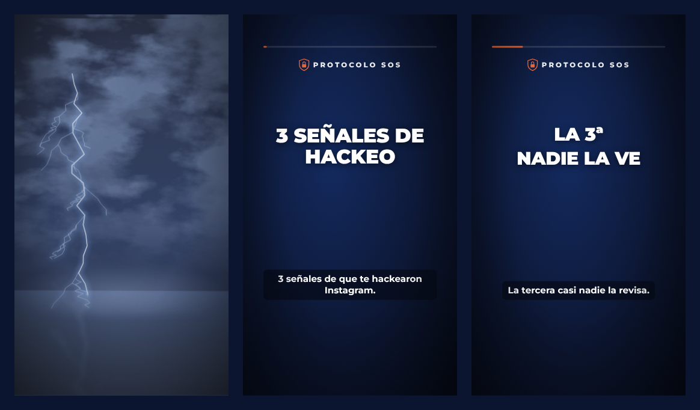

<p align="center">
  
</p>

<p align="center">
  
  
  
  
</p>

<h3 align="center">Del "tengo una idea" al Reel publicado y medido.<br>La IA hace el trabajo pesado; tú apruebas cada paso.</h3>

---

## 🎬 Cómo se ve

<p align="center">
  
</p>

Apertura con tormenta y chispas generadas por código, títulos centrados en la zona segura de Instagram y subtítulos quemados para quien mira sin sonido.

## 🔁 El ciclo

```
Idea → 3 ganchos puntuados → guion → tiempos → caption → voz → video (Remotion) → publicar → métricas
  ↑                                                                                              |
  └─────────────────────────────── 48 h: qué funcionó → próximo guion ───────────────────────────┘
```

## 🧰 Qué incluye

| Carpeta | Qué hace |
|---|---|
| `skills/` | 4 skills para Claude (escritorio o Claude Code): guionista, video, servidor de Instagram y producción en lote. |
| `mcp/` | Servidor MCP de Instagram: publicar Reels, leer métricas, detectar patrones de lo que funciona. |
| `guion/` | Herramientas en Python sin dependencias: puntuador de ganchos (26 fórmulas en español), hoja de tiempos, control del caption, voz con IA, procesado "de cine" de la voz. |
| `video/` | Plantilla de Remotion 1080×1920: apertura con tormenta y chispas generadas por código, títulos centrados en zona segura, subtítulos quemados, efectos de sonido. |
| `docs/` | Instalación paso a paso. |

## 🚀 Empezar

1. Lee **[docs/instalacion.md](docs/instalacion.md)** (30–60 minutos la primera vez).
2. Copia `.env.example` como `.env` y completa tus datos. **Nunca subas el `.env`.**
3. Copia `guion/voice.plantilla.md` como `guion/voice.md` y descríbete. Mira `guion/voice.ejemplo.md` de referencia.
4. Instala las skills de `skills/` en Claude y pídele: *"escribe el guion de un Reel sobre…"*.

## 🤖 ¿Funciona con otras IA?

Sí. Nada de esto está atado a un asistente:

- **Servidor de Instagram (`mcp/`)**: usa [MCP](https://modelcontextprotocol.io), un estándar abierto. Funciona con cualquier asistente o editor que soporte servidores MCP.
- **Skills (`skills/`)**: son archivos Markdown con instrucciones. Si tu IA no tiene "skills", pega el `SKILL.md` como instrucciones del proyecto o del sistema.
- **Herramientas de guion y video (`guion/`, `video/`)**: son scripts de Python y un proyecto de Remotion; los corres tú o cualquier agente que pueda ejecutar comandos.

Cada persona usa **sus propias** cuentas y claves (Instagram, Supabase, voz), que van en **su** `.env`.

## 📋 Requisitos

- Node.js 20+ y Python 3.10+
- Cuenta de Instagram **profesional** (creador o empresa) y una app en [Meta for Developers](https://developers.facebook.com)
- Proyecto gratis en [Supabase](https://supabase.com) (para alojar el video al publicar)
- Opcional: voz con IA (ElevenLabs de pago, o Kokoro / Edge gratis)

## 🛡️ Principios

- **Nada se publica sin tu aprobación.** Las skills escriben y producen; publicar lo decides tú.
- **Evidencia antes que reglas:** cada guion parte de las métricas reales de tu cuenta.
- **Cero automatización de interacciones** (likes, follows, comentarios en otras cuentas). Va contra las reglas de Instagram.
- **Secretos solo en `.env`.** Ver [SECURITY.md](SECURITY.md).

## 📄 Licencia

MIT. Ver [LICENSE](LICENSE) y [CREDITS.md](CREDITS.md) (incluye la licencia de Remotion, que tiene condiciones para empresas).

## 👤 Autor

**Cristian Rodas** · creador de [@protocolosos.guia](https://instagram.com/protocolosos.guia)

Si te sirve, deja una ⭐ y cuéntame qué Reel hiciste con el kit.
